# Rangers

A cast of coding agents that plan, build and review your work. Answer them from your tablet.

[Docs](docs/index.md) · [Agents](agents) · [Rules](rules) · [Dependencies](deps.toml)

Rangers is a set of Claude Code agents, rules and a small Go program, built on open source parts that already coordinate agents: pstack, grilling, i-have-adhd and container-use. Each agent is one short Markdown file with its role, model and limits. Everything runs on your own computer with your own Claude account. There is no hosted service.

- **Plans you can read anywhere.** Each plan is a private page in plain words, with the scenarios, a flowchart and a before-and-after data table. One yes starts the work.
- **One role per agent.** A coordinator, an author, a swarm of authors, two reviewers, QA, an explorer, a docs writer, a gate, a courier and a learner, each with its own model and effort.
- **It learns from your corrections.** `rangers learn` reads what you typed in your sessions, proposes rules on a local branch and writes notes to your notes folder.
- **Cheap on purpose.** Three gates keep it from running when there is nothing new: a minimum interval, a minimum number of new lines and a cap per day. Each round also has its own dollar cap, and logs its time, tokens and cost.
- **You stay in control.** Nothing merges or deploys without you, and production always needs your explicit yes.

## The cast

| | Agent | What it does |
| --- | --- | --- |
| 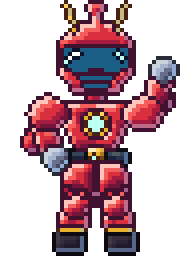 | Jason | Coordinator. Refines the task with you, plans, and hands the work out. Never writes code. |
| 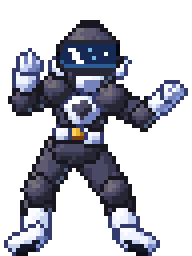 | Zack | Author. Writes one test per scenario, then the code, and opens its own pull request. |
| 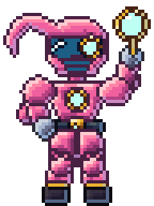 | Kimberly | Reviewer. Reads the pull request, and only a finding with proof counts. |
| 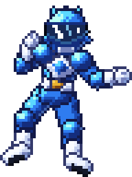 | Billy | Explorer. Finds out how code and data work, read only, with a file and line for every claim. |
| 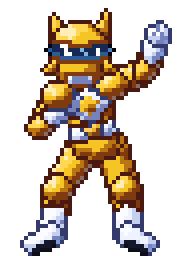 | Trini | Docs writer. Builds the `docs` folder by the Diátaxis method. Called only by you. |
| 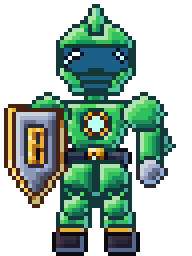 | Tommy | Gate. A program with no model that checks your yes and the CI before a merge. |
| 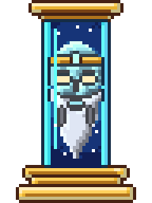 | Zordon | Mentor. Learns from your corrections and writes the notes. |
| 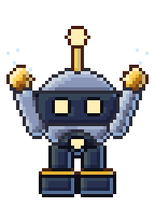 | Alpha 5 | Courier. Delivers the plan as a page and sends the reminder. |
| 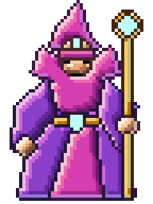 | Rita Repulsa | Adversarial reviewer. Attacks risky changes before they go in. |
| 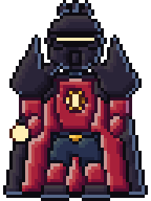 | Lord Zedd | QA. Tests each scenario and tries to break it. |
| 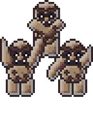 | The Putties | Swarm. Several workers in parallel on separate units. |

Each one is a Markdown file in [`agents/`](agents).

## Install

You need Claude Code, Git, `gh` logged in, Go 1.26, Homebrew and Podman, with its machine started and the `docker` command answering (a `docker` link to `podman` works). `~/.local/bin` must be in your `PATH`. The full list is in [what the machine needs](docs/reference/dependencies.md#what-the-machine-needs).

```sh
git clone https://github.com/malaquiasdev/rangers
cd rangers
make hooks
mkdir -p ~/.local/bin
go build -o ~/.local/bin/rangers ./cmd/rangers
rangers install
```

`rangers install` installs the pieces in `deps.toml` and links the agents, the rules, the entry skill and the `bin/` helpers into `~/.claude`. Then restart Claude Code and run `/pstack:setup-pstack` once. `rangers install --check` shows what is in place and ends with `All in place.` when nothing is missing. If the `docker` line says `NOT RESPONDING`, start Podman with `podman machine start`. The [step-by-step tutorial](docs/tutorials/prepare-the-machine.md) walks through the same setup, and [how to uninstall](docs/how-to/uninstall.md) undoes it.

## Use

Start a task with a Linear issue, a GitHub issue or a short description:

```
/rangers ABC-123
```

To let it learn from your sessions, schedule it every two hours. This needs macOS. The job reads fixed default folders, so check them first in [how to schedule the learning job](docs/how-to/schedule-learning.md).

```sh
~/.local/bin/rangers schedule install
```

## Develop

```sh
make check
```

The checks also need `golangci-lint` and Python 3.11 or newer. They run locally through git hooks, so the only GitHub workflow is release-please. More in the [docs](docs/index.md).

## Credits and license

Built on [pstack](https://github.com/cursor/plugins/tree/main/pstack), [i-have-adhd](https://github.com/ayghri/i-have-adhd), [Matt Pocock's skills](https://github.com/mattpocock/skills) (grilling, grill-with-docs, domain-modeling), [Obsidian skills](https://github.com/kepano/obsidian-skills), [container-use](https://github.com/dagger/container-use), [lychee](https://github.com/lycheeverse/lychee), [humanizer](https://github.com/blader/humanizer) and the [Diátaxis skill](https://github.com/sammcj/agentic-coding). Thank you to everyone behind them.

Released under the [MIT License](LICENSE).
